# Informe — La raíz que se esconde

**Comparación de métodos de búsqueda de raíces y su convergencia**
Universidad Católica del Maule · Laboratorio evaluado 2

**Integrantes:**
- Blas Emilio Rojas Díaz
- Joaquín Alonso Hernández Castro

---

## 1. Introducción y ambiente controlado

Se implementaron con `numpy` seis métodos (bisección, falsa posición, punto fijo, secante, Newton-Raphson y Newton mejorado) y se aplicaron a seis funciones. Parámetros: tolerancia `1e-6`, máximo 100 iteraciones y criterio de parada `|f(xₙ)| < tol` o `|xₙ − xₙ₋₁| < tol`. El error es `|xₙ − r|`, con `r` calculada con 200 bisecciones en `float64`. Todo se genera con `python src/scripts/main.py`.

| Función | Intervalo [a, b] / x₀ | Raíz r | Demostración de la raíz |
|---|---|---|---|
| f₁ = x³ − x − 2 | [1, 2] · x₀ = 1,5 | 1,5214 | f(a)·f(b) = −8 < 0 |
| f₂ = (x − 2)² | [1, 3] · x₀ = 1,2 | 2 | Tangencia: f(2) = f′(2) = 0, f ≥ 0; f(a)·f(b) = +1 |
| f₃ = ln x + x − 4 | [2, 3] · x₀ = 2,5 | 2,9263 | f(a)·f(b) = −0,129 < 0 |
| f₄ = e⁻ˣ − x | [0, 1] · x₀ = 0,5 | 0,5671 | f(a)·f(b) = −0,632 < 0 |
| f₅ = cos x − x | [0, 1] · x₀ = 0,5 | 0,7391 | f(a)·f(b) = −0,460 < 0 |
| f₆ = √x − cos x | [0,1; 1] · x₀ = 0,55 | 0,6417 | f(a)·f(b) = −0,312 < 0 |

Secante: (x₀, x₁) = (a, b); en f₂, (1,2; 1,5). Gráficos de cada función con su raíz marcada:

| | | |
|---|---|---|
| 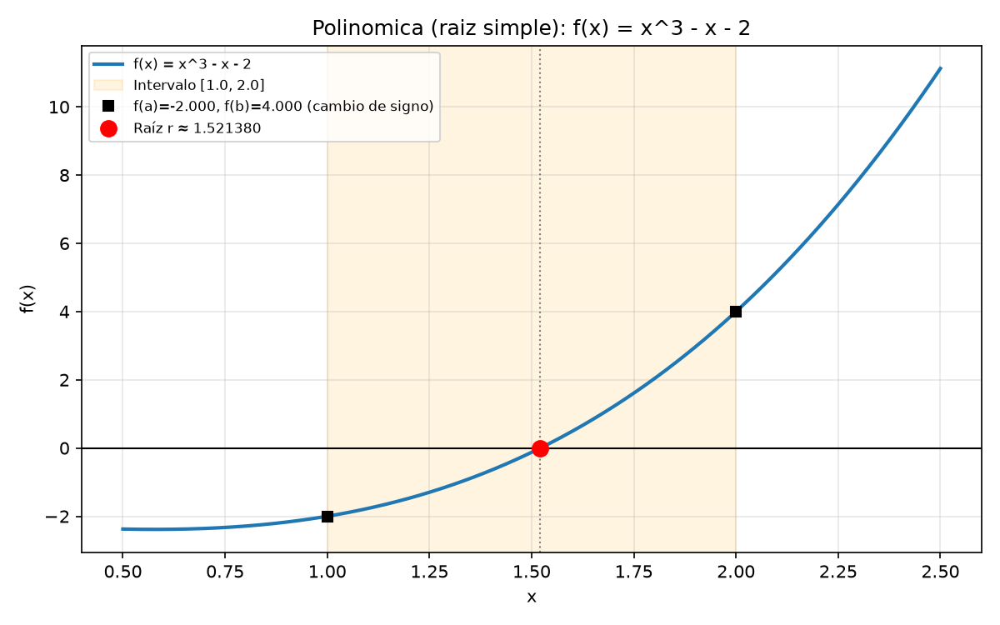 | 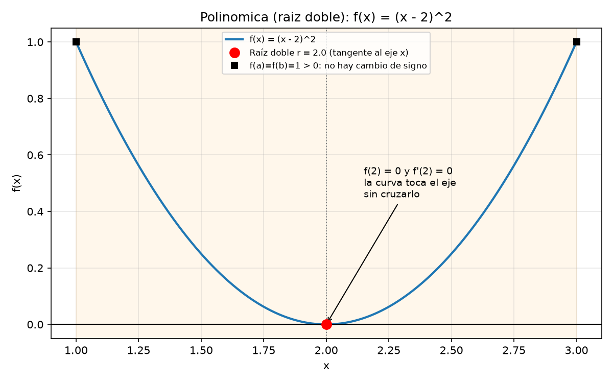 | 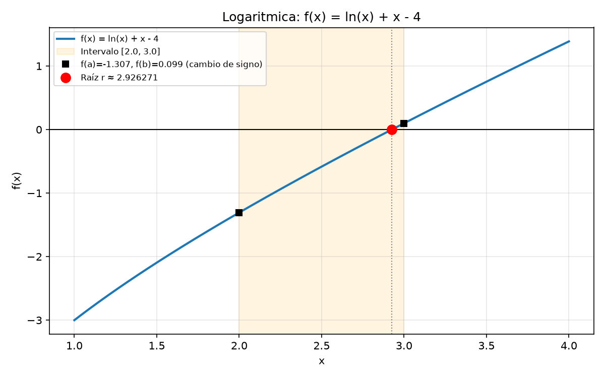 |
| 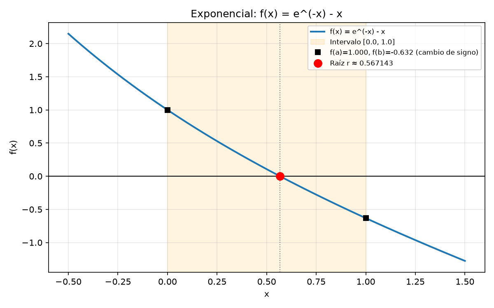 | 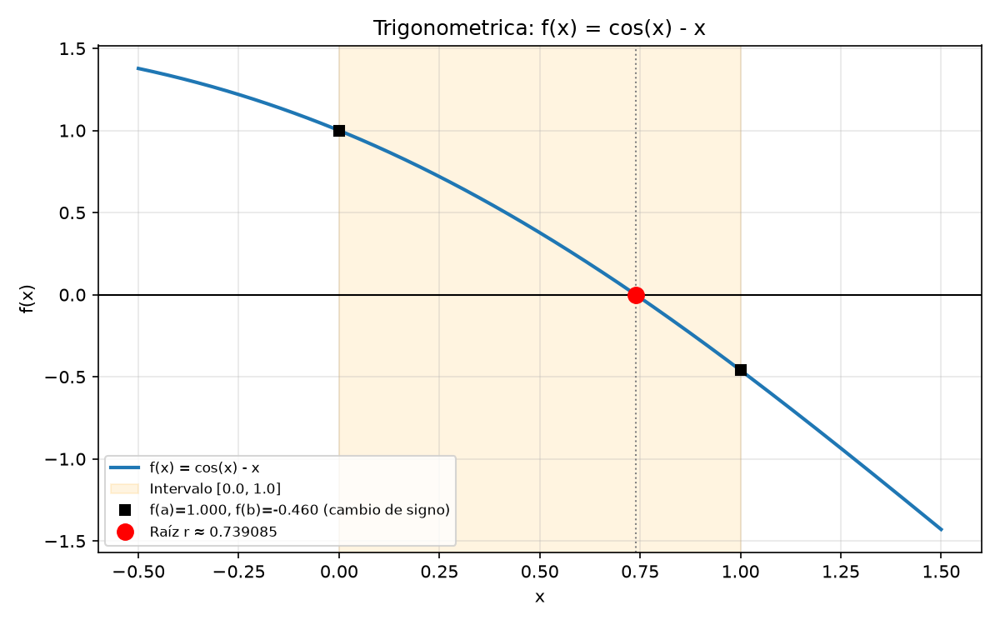 | 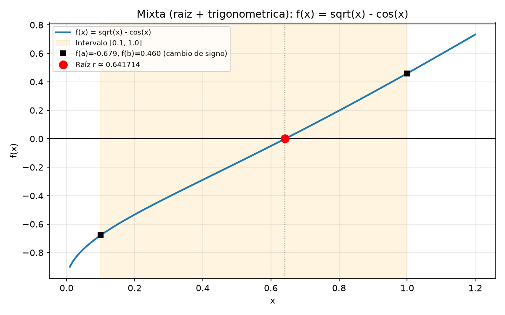 |

## 2. Resultados

Iteraciones hasta cumplir el criterio de parada (N/A = no aplica, ✗ = no converge):

| Función | Bisección | Falsa posición | Punto fijo | Secante | Newton | Newton mejorado |
|---|---|---|---|---|---|---|
| f₁ | 20 | 12 | 7 | 6 | **2** | **2** |
| f₂ (raíz doble) | N/A | N/A | ✗ | 13 | 10 | **1** |
| f₃ | 19 | 4 | 13 | **3** | **3** | **3** |
| f₄ | 20 | 7 | 21 | 4 | **2** | **2** |
| f₅ | 20 | 5 | 33 | 4 | **3** | **3** |
| f₆ | 20 | 4 | 8 | 3 | **2** | **2** |

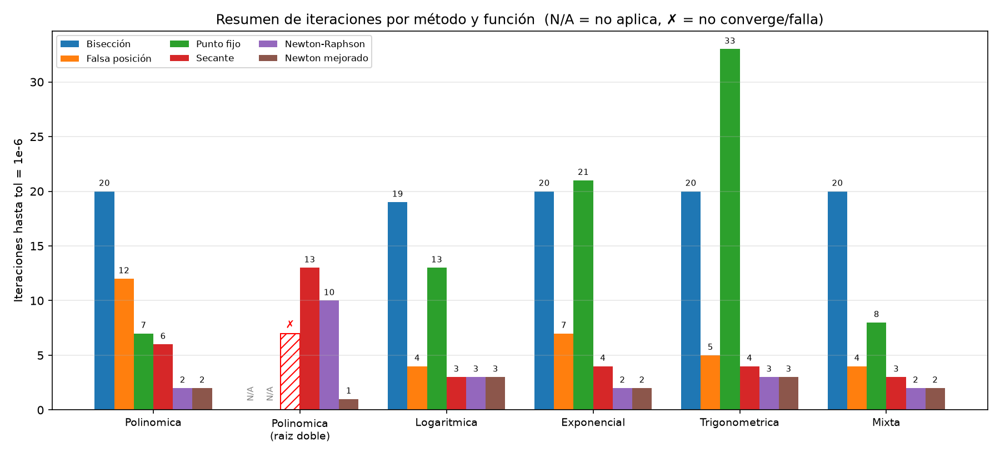

## 3. Preguntas de convergencia

**1. ¿Qué método convergió en menos iteraciones en cada función? ¿Por qué?**

Según la tabla anterior, Newton y Newton mejorado ganan en todas las funciones con raíz simple (2–3 iteraciones; en f₃ empatan con la secante) y Newton mejorado gana en la raíz doble (1 iteración, frente a 10 de Newton y 13 de la secante). Los métodos de orden cuadrático duplican aproximadamente los dígitos correctos en cada paso: en f₃ el error llega a 6,3·10⁻¹³ en 3 iteraciones, mientras que la bisección necesita 19 para llegar solo a 3,8·10⁻⁷. La bisección requiere ≈ log₂((b−a)/tol) ≈ 20 pasos en cualquier función, porque solo usa el signo de f y no su forma.

**2. ¿Qué orden de convergencia tiene cada método y cómo se refleja en el gráfico |error| vs iteración?**

| Método | Orden teórico | Orden empírico |
|---|---|---|
| Bisección | Lineal | No estimable (error no monótono) |
| Falsa posición / Punto fijo | Lineal | 1,00 |
| Secante | ≈ 1,618 | 1,52 – 1,91 |
| Newton / Newton mejorado | Cuadrático | 1,92 – 2,06 |

En el gráfico |error| vs iteración (escala log) los métodos lineales aparecen como **rectas**, la secante como una curva leve y Newton como una curva que **se desploma** en 2–3 puntos.

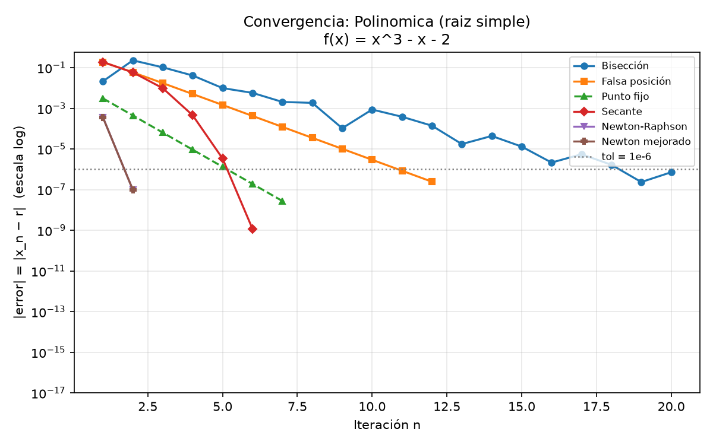

**3. ¿Qué métodos requieren un intervalo con cambio de signo y cuáles no?**

- **Requieren cambio de signo** `f(a)·f(b) < 0` (cerrados): **bisección** y **falsa posición**. Si no se cumple, el código devuelve «No aplica» (en f₂, tanto con [1, 3] como con [0, 4]).
- **No lo requieren** (abiertos): **punto fijo, secante, Newton y Newton mejorado**, que parten de una o dos estimaciones. A cambio, no garantizan convergencia: dependen de que la estimación inicial sea adecuada (ver pregunta 5).

**4. En la función que toca el eje x (raíz doble): ¿qué métodos fallan o no aplican y cuál se comporta mejor? ¿Por qué?**

- Bisección y falsa posición **no aplican**: `f(a)·f(b) = +1 > 0`.
- Punto fijo **diverge** (`g′(2) = 1`, no es contracción).
- Secante (13 it.) y Newton (10 it.) bajan a convergencia **lineal** (orden 1,00; Newton reduce el error a la mitad por paso). Además se detienen con error ≈ 10⁻³, porque `|f| < 10⁻⁶` equivale a `|x − 2| < 10⁻³`.
- **Newton mejorado es el mejor**: resuelve en 1 iteración con error 0, ya que elimina la multiplicidad al aplicar Newton a `f/f′`.

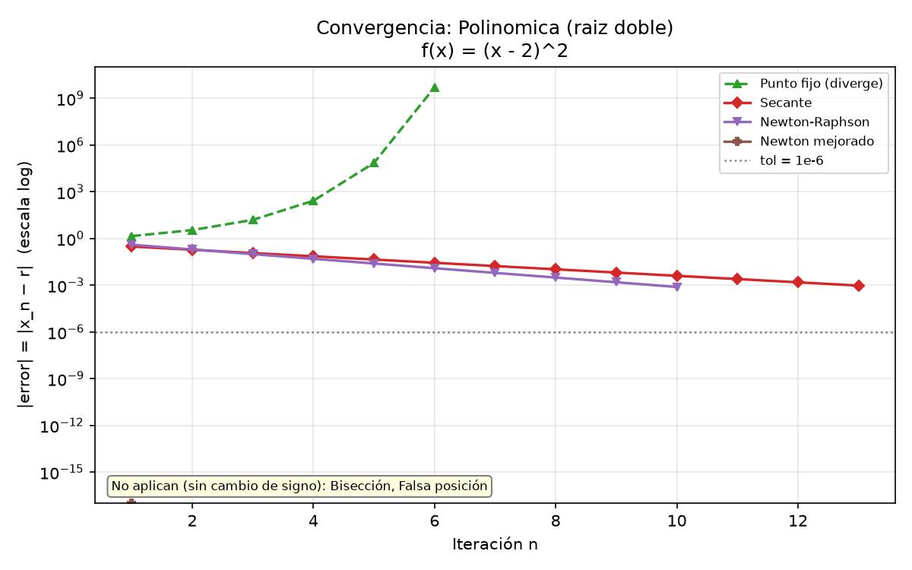

**5. ¿Cómo influyen el intervalo inicial y la estimación inicial en la cantidad de iteraciones y en si el método converge?**

**(a) Intervalo inicial en métodos cerrados** (de menor a mayor amplitud):

| Función | Intervalos | Bisección | Falsa posición |
|---|---|---|---|
| 1 | [1,2] · [0,3] · [−5,10] · [−100,100] | 20 · 22 · 24 · 28 | 12 · 30 · **✗ · ✗** |
| 3 | [2,3] · [1,5] · [0,5;10] · [0,01;1000] | 19 · 21 · 23 · 29 | 4 · 8 · 11 · 25 |
| 4 | [0,1] · [−1,2] · [−10,20] · [−30,100] | 20 · 21 · 24 · 26 | 7 · 14 · **✗** · 2* |
| 5 | [0,1] · [−1,2] · [−10,10] · [−100,100] | 20 · 21 · 23 · 24 | 5 · 8 · 7 · 6 |
| 6 | [0,1;1] · [0,01;2] · [10⁻⁴;50] · [10⁻⁶;10⁴] | 20 · 20 · 25 · 31 | 4 · 7 · 11 · 12 |

\* **Convergencia espuria:** en f₄ con [−30, 100] la falsa posición «converge» en 2 iteraciones a x = 100 (error real 99,4). Como f(−30) ≈ 10¹³, la cuerda corta al eje casi en el extremo derecho y el criterio `|xₙ − xₙ₋₁| < tol` se cumple lejos de la raíz.

- **Bisección** crece de forma predecible, `n ≈ log₂((b−a)/tol)`: de [1, 2] a [−100, 100] pasa de 20 a 28 iteraciones y siempre converge.
- **Falsa posición** es mucho más sensible: con intervalos amplios y curvatura marcada **deja de converger** en 100 iteraciones (f₁ con [−5, 10] y [−100, 100]; f₄ con [−10, 20]), pues un extremo del intervalo queda casi fijo.

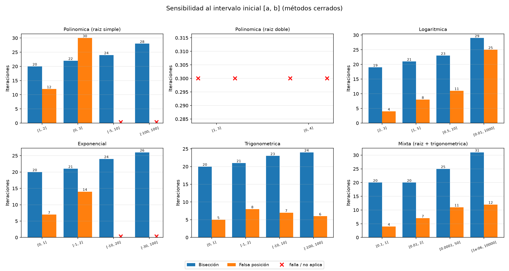

**(b) Estimación inicial en métodos abiertos** (iteraciones; ✗ = falla o no converge; tabla completa en `src/data/sensibilidad.csv`):

| Función | x₀ probados | Punto fijo | Secante (x₁ = x₀ + 0,1) | Newton | Newton mejorado |
|---|---|---|---|---|---|
| 1 | 1,5 · 5 · 0,5 · 0 | 7 · 9 · 9 · 9 | 3 · 9 · 28 · 9 | 2 · 7 · **37** · **30** | 2 · 13 · 28 · 4 |
| 3 | 2,5 · 0,1 · 10 · 600 | 13 · 15 · 15 · ✗ | 3 · 6 · 5 · ✗ | 3 · 5 · 4 · ✗ | 3 · ✗ · 3 · ✗ |
| 5 | 0,5 · 3 · 10 · −1,5 | 33 · 34 · 32 · 35 | 3 · 7 · 7 · 7 | 3 · 5 · **✗** · 21 | 3 · 5 · 21 · 12 |
| 6 | 0,55 · 0,01 · 5 · 50 | 8 · 10 · 11 · 20 | 2 · 5 · ✗ · ✗ | 2 · 4 · ✗ · ✗ | 2 · ✗ · ✗ · ✗ |

En f₁, Newton pasa de 2 iteraciones (x₀ = 1,5) a 37 (x₀ = 0,5), porque cerca de x = ±0,577 se anula f′. Las fallas se deben a salir del dominio (f₃ con x₀ = 600: el primer paso cae en x < 0 y ln x no existe), a derivadas casi nulas (f₅ con x₀ = 10) o a cancelación numérica en Newton mejorado.

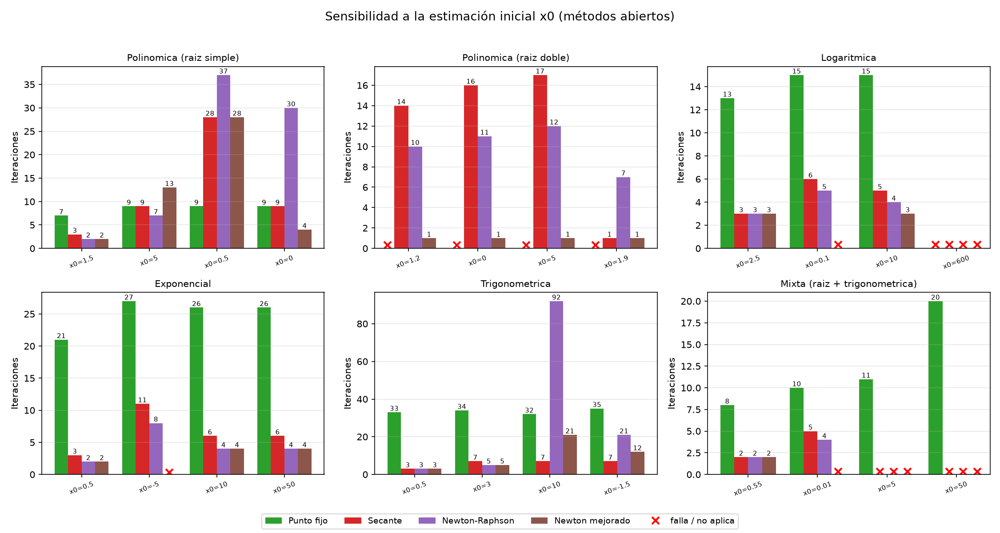

**6. ¿Qué método recomiendan según el tipo de función, considerando el compromiso entre velocidad y robustez?**

| Tipo | Método | Motivo |
|---|---|---|
| Polinómica (raíz simple), exponencial | Newton | 2 iteraciones; en f₄ convergió desde todos los x₀ probados |
| Logarítmica, trigonométrica | Secante | 3–7 iteraciones, sin derivada, estable en f₅ |
| Raíz doble | Newton mejorado | 1 iteración; los demás se degradan o fallan |
| Mixta o sin buena estimación inicial | Híbrido: bisección y luego Newton | Newton y secante fallan con x₀ lejanos (f₆) |

## 4. Conclusión

1. **Método por tipo de función:** Newton es el más rápido (2–3 iteraciones) cuando hay una buena estimación inicial, y la secante es la alternativa sin derivada. A cambio, los métodos abiertos fallaron con estimaciones lejanas, mientras que la bisección convergió en todos los intervalos con cambio de signo probados (19–31 iteraciones). Por eso recomendamos una estrategia híbrida: acotar con bisección y refinar con Newton.
2. **Raíz doble:** en (x − 2)² la raíz existe (f(2) = f′(2) = 0) pero no hay cambio de signo, por lo que los métodos cerrados no aplican. El cambio de signo es condición suficiente pero no necesaria para tener raíz: Bolzano no detecta raíces de multiplicidad par. Además, Newton y secante pasan a convergencia lineal, y solo Newton mejorado recupera la convergencia cuadrática.
3. **Intervalo y estimación inicial:** al ampliar el intervalo, la bisección pasó de 20 a 28 iteraciones, la falsa posición de 12 a 30 hasta dejar de converger, y en Newton mover x₀ cambió el costo de 2 a 37 iteraciones o provocó fallas. Una mala elección inicial puede costar más que cambiar de método.
